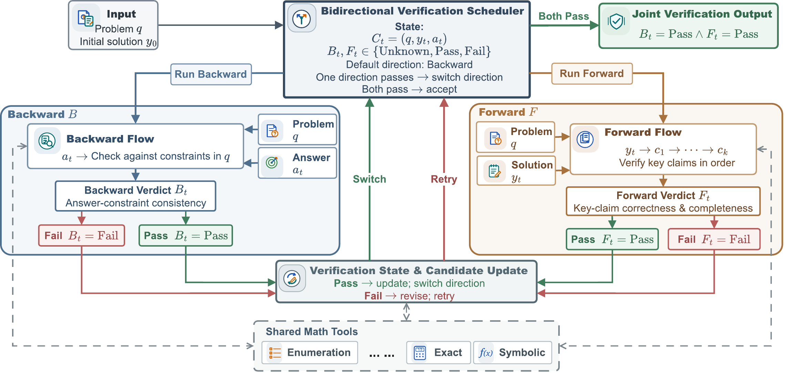
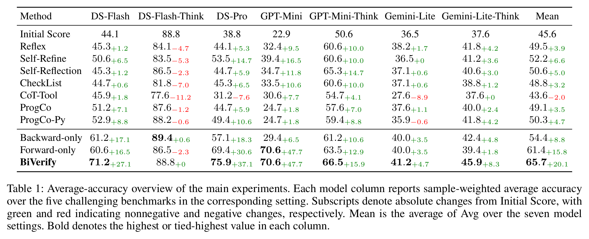

# BiVerify：用于数学自纠错的双向验证

**BiVerify: Closing the Loop Between Backward and Forward Verification for Mathematical Self-Correction**

数学答案即使满足题目给出的条件，推导过程也可能有错，或者没有找全题目要求的解。BiVerify 从两个方向验证同一份解答：先从答案出发，检查它是否满足原题条件，再按解题顺序检查关键推理是否正确、是否完整。

## 方法框架

[](assets/framework.png)

图左是反向验证，图右是正向验证。两个方向都可以调用数学工具。一个方向通过后，调度器切换到另一个方向；验证失败时，系统根据反馈修正解答或调整验证步骤，再次检查。只有同一份解答在两个方向上都通过，调度器才接受它。达到验证次数上限时，系统返回当前解答。

## 主要结果

[](assets/main-results.png)

## 安装与环境配置

在仓库根目录执行：

```bash
python -m pip install -r requirements.txt
```

示例调用 DeepSeek 官方 API。请设置 `DEEPSEEK_API_KEY`。PowerShell 使用 `$env:DEEPSEEK_API_KEY = "<your-key>"`，Bash 使用 `export DEEPSEEK_API_KEY="<your-key>"`。

## 快速开始

仓库附带的 `demo` 包含两道数学题。执行下面两步会调用模型。

### 1. 生成公共初答

```bash
python 0-1_initial_response/generate_initial_responses.py --dataset demo --output-dir runs/initial
```

初答保存在本地 `runs/initial/deepseek-flash_demo_first_response.jsonl`，评分保存在同目录的 `demo.initial-eval.json`。比较不同方法时可共用这批初答，在第 2 步用 `--initial-dir` 指向保存初答和版本记录的目录。

### 2. 运行 BiVerify 并评分

```bash
python 0-3_all_model_test/run_plan_S_SC/S_SC_S4-2_BiVerify/run_biverify.py --dataset demo --initial-dir runs/initial --run
```

程序读取初答，启动本地 Python 工具并执行双向验证与纠错。每次运行默认写入 `runs/<UTC时间戳>/`。其中 `model_outputs/demo.json` 保存逐题推理和最终回答，`evaluation.json` 保存统一评分结果。参考答案仅用于评分。Python 工具会在本机执行模型生成的代码，请使用专用、低权限的环境。

要改跑 HMMT，请先按 `0-0_datasets/README.md` 准备题集，再将两步命令中的 `--dataset demo` 换成 `--dataset hmmt_feb_2025`。

部分验证与纠错代码改编自 ProgCo，详见[来源说明](THIRD_PARTY.md)。

## 引用

arXiv 链接待补。

```bibtex
@misc{zou2026biverify,
  title = {{BiVerify}: Closing the Loop Between Backward and Forward Verification for Mathematical Self-Correction},
  author = {Zou, Rui and Zhao, Xin and Wei, Mengqi and Wen, Ji-Rong},
  year = {2026}
}
```
